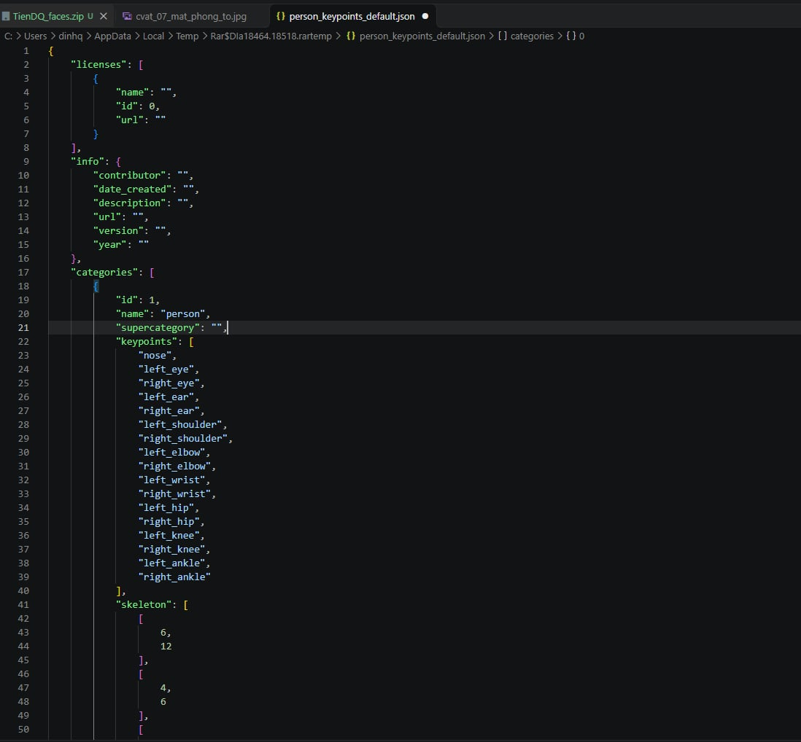
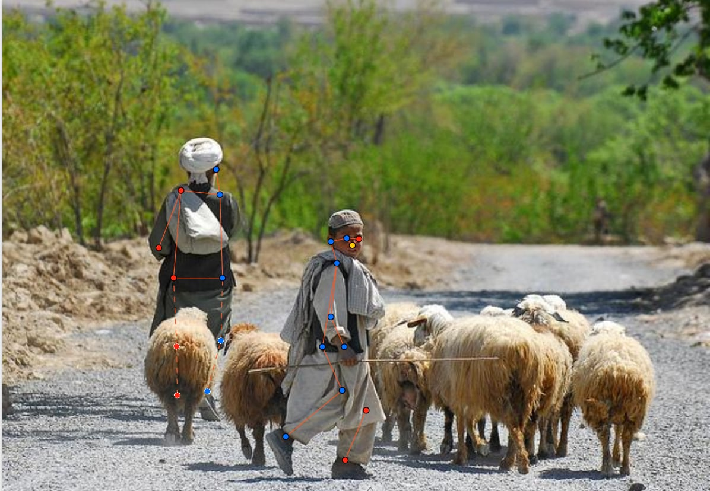
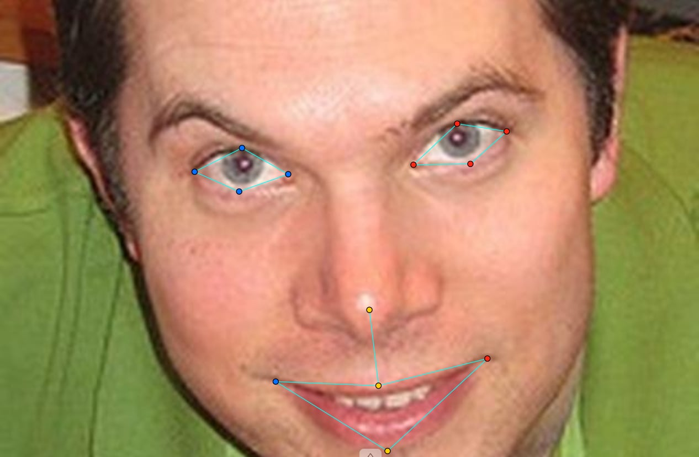

# Báo cáo cá nhân — Đinh Quốc Tiến-2A202603028

## 0. Thông tin học viên

- Họ tên: Đinh Quốc Tiến
- MSSV: 2A202603028
- Email: 26ai.tiendq@vinuni.edu.vn
- Link repository: https://github.com/NEITP/K5-L2A-TienDQ-2A202603028-KeypointPose-Student.git
- Phiên bản CVAT (Help → About): Chưa xác định
- Máy: Windows 11 · RAM 16 GB · chạy CVAT chế độ đầy đủ
- Bộ ảnh (`src/exports/assignment.json` do `lab.py setup` tạo): Có
- Giờ bắt đầu: 19:00
- Giờ kết thúc: 
## 1. Kiểm tra label (CP0)

| Label | Kiểu | Số điểm | Tên điểm đúng bảng của lab? | Đúng thứ tự? | Số cạnh |
|---|---|---:|---|---|---:|
| `person` | Skeleton | 17 | Có (nose, left_eye, right_eye, left_ear, right_ear, left_shoulder, right_shoulder, left_elbow, right_elbow, left_wrist, right_wrist, left_hip, right_hip, left_knee, right_knee, left_ankle, right_ankle) | Có (1 → 17) | 19 |
| `face` | Skeleton | 13 | Có (left_eye_outer/inner/upper/lower, right_eye_outer/inner/upper/lower, nose_tip, mouth_left, mouth_right, lip_upper, lip_lower) | Có (1 → 13) | 13 |

Mẫu `person` dựng theo người quay mặt về camera (các điểm `left_*` nằm bên phải khung mẫu)? **Có**

Cách đổi cờ `occluded` / `outside` cho **một điểm** trên phiên bản CVAT này (một câu):

Chọn điểm đó (bấm vào điểm trên ảnh, hoặc mở rộng skeleton ở danh sách đối tượng bên phải rồi chọn dòng của điểm), sau đó bấm nút Occluded (phím `Q`) để đặt `v = 1` hoặc nút Outside (phím `O`) để đặt `v = 0`; để cả hai tắt là `v = 2`.

## 2. Số lượng đã gán và thời gian (CP1, CP2)

| Nhóm ảnh | Số ảnh | Số skeleton đã gán | Số người dưới 60 px (không gán) | Số poster / gương / màn hình bỏ qua | Thời gian (phút) |
|---|---:|---:|---:|---:|---:|
| `easy` | 5 | 5 | — | — | — |
| `occluded` | 3 | 6 | — | — | — |
| `back` | 2 | 4 | — | — | — |
| `small` | 1 | 3 | — | — | — |
| `crowd` | 1 | 3 | — | — | — |
| `faces` | 8 | 8 | — | — | — |

- Số ảnh người đã xong ở mốc phút 105: 12
- Thời gian thực tế: CP1 120 phút · CP2 30 phút · CP3 20 phút


## 3. Bảng ca khó (CP1, CP2)

Mỗi điểm bạn phân vân một dòng, nhất là phân vân giữa `v = 1` và `v = 0`, hoặc không chắc hướng người.

| Ảnh | Người / mặt | Điểm | Cờ đã chọn | Phân vân giữa | Lý do chọn |
|---|---|---|---:|---|---|
| 000000480582 | Người nghiêng bên phải ảnh (x ≈ 256–329) | left_shoulder, left_elbow, left_wrist, left_hip | 0 | `v = 0` / `v = 1` | Nửa người bên trái quay khuất sau thân (mũi quay sang phải, chỉ thấy tai phải), nhưng left_knee và left_ankle vẫn thấy rõ (`v = 2`). Điểm bị chính thân che nên chọn 0 vì không thể xác định vị trí thật; nếu lab quy định "che mà đoán được vị trí thì `v = 1`" thì đổi sang 1. |
| 000000269462 | 3 người nhỏ quay lưng (x ≈ 151–203, 292–333, 394–445) | nose, left_eye, right_eye, left_ear, right_ear | 0 | `v = 0` / `v = 1` | Người quay lưng nên mũi và mắt bị chính đầu che. Mặt không thấy và tọa độ không đoán được ở độ phân giải thấp nên chọn 0. |
| 000000326480 | Người giữa, x ≈ 343–412 | right_shoulder, right_elbow, right_wrist | 0 | `v = 0` / `v = 1` | Vai phải nằm sát người bên cạnh (mũi người đó ở x ≈ 338, vai trái x ≈ 333) nên có thể bị người này che. Không thấy rõ nên chọn 0. |
| 000000469061 | Người thấp hơn, phía sau (x ≈ 141–299) | nose, left_eye, right_eye, left_ear, right_ear | 0 | `v = 0` / `v = 1` | Đầu nằm sau người cao hơn (x ≈ 161–309) che mất, không có điểm nào thấy được. Chọn 0 vì không có chi tiết để đặt điểm. |
| 000000225138 | Người duy nhất | left_eye, right_eye, left_ear, right_ear | 1 | `v = 1` / `v = 2` | Mũi vẫn thấy (`v = 2`) nhưng mắt và tai bị che một phần (đầu nhỏ, nghiêng). Vị trí đoán được rõ nên chọn 1 thay vì 0. |
| 000000225138 | Người duy nhất | left_hip, left_knee, left_ankle | 1 | `v = 1` / `v = 2` | Chân trái bị chân phải che nhưng đường chân vẫn nhìn ra nên đặt 1, không đặt 0. |
| face_301643 | Mặt 5 | 8 điểm mắt (left_eye_*, right_eye_*) | 1 | `v = 1` / `v = 2` | Cả hai mắt bị che cùng lúc (kính hoặc vật che) trong khi mũi và miệng vẫn rõ nên đặt cả 8 điểm là 1 để nhất quán. |
| face_79591 | Mặt 8 | left_eye_outer, left_eye_inner, mouth_left | 1 | `v = 1` / `v = 2` | Mặt xoay mạnh sang phải ảnh (mũi vượt qua mắt trái). Khóe mắt trái và khóe miệng trái bị mũi che nên chọn 1; mi trên và mi dưới vẫn thấy nên giữ 2. |
| face_223746 | Mặt 4 | right_eye_outer, left_eye_inner | 1 | `v = 1` / `v = 2` | Mặt xoay sang trái ảnh nên đuôi mắt phải bị lẹm khỏi biên mặt; left_eye_inner khó chắc chắn nên chọn 1. |

## 4. Bảng tự review (CP3)

Đi từ ảnh cuối về ảnh đầu. 5 ảnh người (ít nhất 2 ảnh `back` hoặc `crowd`) và 3 ảnh mặt. Ít nhất 8 dòng, kể cả dòng `ok`. Ghi lỗi trước, sửa sau.

Mã lỗi dùng đúng một trong: `lr_swap`, `vis_flag`, `position`, `missing`, `extra`, `ok`.

Ảnh `crowd`/`back` đã chọn: 000000326480 (3 người, crowd) và 000000269462 (3 người, crowd + quay lưng).

| Ảnh | Người / mặt | Điểm | Mã lỗi | Ghi chú | Đã sửa? |
|---|---|---|---|---|---|
| 000000558066 | Người duy nhất | nose → hông (13 điểm) | `ok` | Nhìn thẳng camera: mắt, tai, vai, khuỷu, cổ tay, hông đều có left_* ở bên phải. Độ dài cánh tay trái/phải 99/79 và 92/89, hợp lý. | Không cần |
| 000000558066 | Người duy nhất | left_knee, right_knee, left_ankle, right_ankle | `vis_flag` | Cả 4 điểm `v = 0` nhưng vẫn nằm ở vị trí mẫu (y ≈ 321–390, cao hơn hông y ≈ 330). Ảnh cao 500 và hông ở y ≈ 330 nên đầu gối có thể vẫn trong ảnh. Nếu chỉ bị che thì phải là `v = 1`. | Chưa, cần mở CVAT xem lại |
| 000000480582 | Người nghiêng bên phải ảnh | left_shoulder, left_elbow, left_wrist, left_hip | `vis_flag` | Cả 4 điểm `v = 0` nhưng left_knee, left_ankle lại `v = 2`. Nửa người trái bị thân che chứ không nằm ngoài ảnh nên nên cân nhắc `v = 1`. | Chưa |
| 000000326480 | Người bên phải (x ≈ 409–493) | nose, left_eye | `missing` | Chỉ có left_ear `v = 2` (459.9, 105.9). Mũi và mắt `v = 0` nhưng tọa độ vẫn là vị trí mẫu cách tai 260 px. Nếu thấy mặt thì phải đặt lại mũi và mắt. | Chưa |
| 000000326480 | Người giữa (x ≈ 343–412) | right_shoulder, right_elbow, right_wrist | `vis_flag` | Cả 3 điểm `v = 0` trong khi nose và left_shoulder `v = 2`. Vai phải nằm sát người bên cạnh nên có thể bị che (`v = 1`) chứ chưa chắc ra ngoài. | Chưa |
| 000000311497 | Người giữa (x ≈ 199–359) | left_knee, right_knee, left_ankle, right_ankle | `lr_swap` | Vai và hông cho thấy người quay mặt (left_* bên phải), nhưng left_knee/ankle (234.6; 226.9) nằm bên trái right_knee/ankle (285.4; 358.5) nên hai chân bắt chéo. Hoán đổi trái/phải cho chân thì thành chân thẳng và chân bước ngang, không còn chéo. | Chưa, cần đổi nhãn left/right của hai chân |
| 000000311497 | Người bên trái (x ≈ 35–123) | left_knee | `vis_flag` | `v = 0` nhưng tọa độ (114.6, 411.5) đặt rất khớp: đùi trái dài 77, đùi phải 78. Đầu gối này có thể đã thấy được nên cần xem lại giữa `v = 0` và `v = 2`. | Chưa |
| 000000269462 | Người thứ 3 từ trái (x ≈ 151–203, quay lưng) | right_knee, right_ankle | `missing` | Hai vai, khuỷu, hông và chân trái đều thấy, nhưng chân phải `v = 0` ở vị trí mẫu. Người đứng quay lưng nên chân phải gần như chắc chắn có trong ảnh. | Chưa |
| face_79591 | Mặt 8 | 13 điểm | `ok` | Mặt xoay sang phải ảnh. Mũi vượt mắt trái, khóe mắt trái và khóe miệng trái `v = 1`, các điểm còn lại `v = 2`, nhất quán với hướng xoay. | Không cần |
| face_504911 | Mặt 7 | 13 điểm | `ok` | Mũi nằm giữa hai mắt (x ≈ 262, trung điểm mắt ≈ 262); đường mắt và đường miệng nghiêng cùng chiều. Chỉ right_eye_inner `v = 1` là điểm hơi phân vân. | Không cần |
| face_421231 | Mặt 6 | lip_upper | `position` | Môi trên (281.6, 416.1) nằm thấp hơn đường nối hai khóe miệng khoảng 11 px, trong khi cả 7 mặt còn lại đều nằm trên hoặc ngang đường này (−0.9 đến −39.8 px). Cần kéo lại lên. | Chưa |

Tổng hợp số lỗi theo mã:

| `lr_swap` | `vis_flag` | `position` | `missing` | `extra` | `ok` |
|---:|---:|---:|---:|---:|---:|
| 1 | 4 | 1 | 2 | 0 | 3 |

Điểm còn phân vân giữa `v = 1` và `v = 0` (ghi cả hai lựa chọn và lý do chọn):

- **Nửa người trái của người nghiêng trong 000000480582** (left_shoulder, left_elbow, left_wrist, left_hip). Hiện là `v = 0`. Lựa chọn khác là `v = 1`. Điểm bị chính thân che nhưng chân cùng bên vẫn thấy, nên nếu lab cho phép đoán vị trí khi bị che thì chọn `v = 1`.
- **Đầu của người quay lưng trong 000000269462** (nose, mắt, tai của 3 người). Hiện là `v = 0`. Lựa chọn khác là `v = 1`. Mặt bị chính đầu che và quá nhỏ để đoán, nên giữ 0.
- **Vai phải, khuỷu phải, cổ tay phải của người giữa trong 000000326480**. Hiện là `v = 0`. Lựa chọn khác là `v = 1` nếu thật sự bị người bên cạnh che. Giữ 0 vì không nhìn thấy chi tiết để đặt điểm.
- **Đầu gối và cổ chân của người trong 000000558066**. Hiện là `v = 0`. Lựa chọn khác là `v = 1` nếu chúng nằm trong ảnh nhưng bị che. Cần xem lại ảnh.


## 5. Kiểm file xuất và kết quả tự kiểm (CP4)

Sau khi xuất, CVAT ghi:
- `occluded` thành `v = 1`
- `outside` thành `v = 0`
- Tọa độ của điểm `outside`: tọa độ cũ (CVAT 2.x), không phải `0, 0`.


### Tóm tắt kết quả tự kiểm

- File person: TienDQ_persons.zip
  - Số ảnh: 12
  - Số skeleton person: 21
  - Mỗi annotation: 51 số
  - v=2: 216 (61%)
  - v=1: 19 (5%)
  - v=0: 122 (34%)
  - num_keypoints trung bình: 11.2

- File face: TienDQ_faces.zip
  - Số ảnh: 8
  - Số skeleton face: 8
  - Mỗi annotation: 39 số
  - v=2: 90 (87%)
  - v=1: 14 (13%)
  - v=0: 0 (0%)
  - num_keypoints trung bình: 13.0

- Hai job đã chuyển sang completed trên CVAT: Có
- Số lỗi: 0
- Số cảnh báo: 2
Các [CẢNH BÁO] còn giữ nguyên và lý do:

1. 000000225138.jpg #1: checker cảnh báo cặp knee có vẻ nằm ngược phía so với các cặp còn lại. Đã kiểm tra trên CVAT và xác nhận annotation đúng theo tư thế thực tế trong ảnh.

2. 000000311497.jpg #1: checker cảnh báo trái/phải không nhất quán giữa shoulder, wrist so với knee, ankle. Đã kiểm tra trên CVAT và xác nhận annotation đúng theo tư thế thực tế trong ảnh.
- Kết quả: ĐẠT

## 6. Ảnh chụp màn hình

1. Label `person` trong label constructor (đủ 17 điểm có tên):

   

2. Một người quay lưng đã gán, cờ đã đặt:

   

3. Một khuôn mặt đã gán 13 điểm, phóng to vùng mắt:

   

4. Một đoạn JSON xuất của một người:

   

Nguồn ảnh: COCO val2017 / Wikimedia Commons.

## 7. Tự đánh giá

1. Lỗi bạn mắc nhiều nhất hôm nay, và cách bạn sẽ tránh ở dự án thật:

   Lỗi nhiều nhất là chọn sai giữa `v = 0` và `v = 1` cho điểm bị che. Trong file person có 122 điểm `v = 0` (34%) nhưng chỉ 19 điểm `v = 1` (5%), tức tôi có xu hướng đặt "ngoài ảnh" cho cả những điểm thật ra chỉ bị che (ví dụ nửa người bị thân che nhưng chân cùng bên vẫn thấy). Ở dự án thật tôi sẽ tự hỏi trước mỗi điểm `v = 0`: "điểm này có nằm trong khung ảnh không?". Nếu có và chỉ bị che thì đặt `v = 1`, và chỉ dùng `v = 0` khi điểm nằm ngoài khung hoặc không thể đoán được. Tôi cũng sẽ kéo điểm `v = 0` về đúng vị trí thay vì để nguyên ở vị trí mẫu.

2. Một quy tắc bạn đề xuất thêm vào guideline (kèm ảnh ví dụ nếu có):

   "Nếu một khớp bị chính thân người hoặc người bên cạnh che nhưng khớp cùng bên ở đoạn chi kề nó vẫn thấy, đặt `v = 1` và kéo điểm về vị trí hợp lý, không để `v = 0`." Ví dụ: ảnh 000000480582, người nghiêng có vai, khuỷu, cổ tay và hông trái bị thân che nhưng đầu gối và cổ chân trái vẫn thấy.

3. Nhãn của bạn đi vào model ở đâu? Chọn một lỗi bạn đã sửa và nói nó sẽ làm model học sai thế nào (heatmap, trọng số trong loss, hay bước lật ảnh):

   Lỗi `v = 1` bị ghi nhầm thành `v = 0` có thể làm mất thông tin giám sát của khớp bị che khuất. Trong bài toán pose estimation sử dụng heatmap, các điểm `v = 0` thường không được tạo heatmap mục tiêu hoặc không tham gia tính loss, tùy cách triển khai. Vì vậy, nếu một khớp thực tế bị che nhưng vẫn xác định được vị trí mà tôi lại gán `v = 0`, model sẽ mất một ví dụ huấn luyện hữu ích về khớp bị che khuất.

   Ngoài ra, lỗi `left/right` có thể ảnh hưởng đến tính nhất quán của nhãn và phép lật ảnh ngang (horizontal flip). Khi augmentation, các cặp trái/phải phải được hoán đổi theo đúng quy tắc. Nếu nhãn ban đầu đã sai, dữ liệu sau augmentation cũng có thể tiếp tục mang nhãn sai.

## 8. Khó khăn và lỗi kỹ thuật
- Phân biệt `v = 0` và `v = 1` ở người bị che hoặc quay lưng 
- Hai cảnh báo của checker ở 000000225138 và 000000311497 (cặp knee, shoulder/wrist/knee/ankle nằm ngược nhau) đã được kiểm tra trên CVAT và xác nhận đúng với tư thế 
- Người nhỏ trong 000000269462 khiến việc đặt điểm đầu khó

## Bonus (nếu làm)

### B1 — 3 ảnh người khó thêm

| Ảnh | Số skeleton | Số người dưới 60 px | Ca khó nhất |
|---|---:|---:|---|
| 000000005294 | 3 | 0 | Người thứ 3 (x ≈ 200–324, 123 × 136 px) chỉ thấy 5 điểm; 12 điểm còn lại `v = 0`, trong đó cả hai vai, hai hông và đầu đều để ngoài. Phân vân giữa `v = 0` và `v = 1` cho thân trên. |
| 000000254060 | 2 | 0 | Người thứ 2 (70 × 251 px, rất hẹp) có 11 điểm `v = 0` và chỉ 6 điểm được gán; vai phải, hông và đầu gối hai bên đều không có. Khó xác định hướng người và nửa thân nào bị che. |
| 000000517702 | 2 | 0 | Người thứ 2 (104 × 292 px, quay lưng) có 9 điểm `v = 1`: cả hai vai, hông, đầu gối, cổ chân đều bị che. Khó chọn `v = 1` hay `v = 0` và giữ đúng trái/phải khi quay lưng. |

Kết quả `src/check_submission.py` cho `TienDQ_bonus_persons.zip`:

```text
=== TienDQ_bonus_persons.zip (label `person`) ===
  [CẢNH BÁO] 000000005294.jpg #2: cặp ankle nằm ngược phía so với các cặp còn lại. Có thể đổi trái/phải một cặp (`lr_swap`), hoặc tay / chân bắt chéo thật: kiểm lại.

----- TÓM TẮT -----
- File person: TienDQ_bonus_persons.zip
  Số ảnh: 3 · số skeleton `person`: 7 · mỗi annotation 51 số
  Skeleton theo ảnh: 000000005294=3, 000000254060=2, 000000517702=2
  Cờ v: v=2 40 (34%) · v=1 29 (24%) · v=0 50 (42%)
  num_keypoints trung bình: 9.9
- Số [LỖI]: 0 · số [CẢNH BÁO]: 1
Kết quả: ĐẠT (đọc lại từng cảnh báo ở trên)
```

Số liệu tôi đọc được từ file: 3 ảnh, 7 skeleton person, mỗi annotation 51 số, `v = 2` 40 (34%), `v = 1` 29 (24%), `v = 0` 50 (42%), `num_keypoints` trung bình 9.9. Cột "Số người dưới 60 px" tính theo khung bao của điểm đã gán (người nhỏ nhất cao 136 px); nếu bạn có bỏ qua người nhỏ không gán thì sửa lại con số này.

### B2 — 5 ảnh khuôn mặt đen trắng / hồng ngoại

Kết quả kiểm tra `TienDQ_bonus_faces.zip`:

- Số ảnh: 5
- Số skeleton face: 5
- Mỗi annotation: 39 số
- v=2: 58 (89%)
- v=1: 3 (5%)
- v=0: 4 (6%)
- num_keypoints trung bình: 12.2
- Số lỗi: 0
- Số cảnh báo: 0

Kết quả: ĐẠT.


Nhận xét về ảnh không màu:

Ảnh không màu làm giảm khả năng phân biệt ranh giới giữa môi, da và bóng đổ. Vì vậy, việc xác định mouth_left, mouth_right, lip_upper và lip_lower khó hơn so với ảnh màu.

Trong bộ 5 ảnh, face_274219 có 3 điểm vùng miệng được gán v = 1. Với face_68290, tôi cần kiểm tra lại 4 điểm vùng miệng đang được gán v = 0 để bảo đảm phân biệt đúng giữa điểm bị che nhưng vẫn xác định được và điểm không thể xác định vị trí.

Về kính râm trên ảnh hồng ngoại: nếu mắt bị kính che hoàn toàn nhưng vị trí vẫn có thể xác định đáng tin cậy thì đặt v = 1; nếu không thể xác định vị trí thì đặt v = 0. Bộ ảnh bonus của tôi không có trường hợp kính râm nên chưa kiểm nghiệm trực tiếp tình huống này.

### B3 — Model so với nhãn của tôi (không tính điểm)

- Demo đã dùng:
- Ảnh đã thử:

1. Model có trả điểm cho khớp bị che, hay khớp ngoài ảnh không? Confidence ở các điểm đó thế nào?

   ...

2. Với người quay lưng, model có đổi trái/phải không?

   ...

3. Bộ điểm của model có giống 17 điểm COCO không?

   ...

## 9. Tài liệu tham khảo và công cụ AI đã dùng

...
